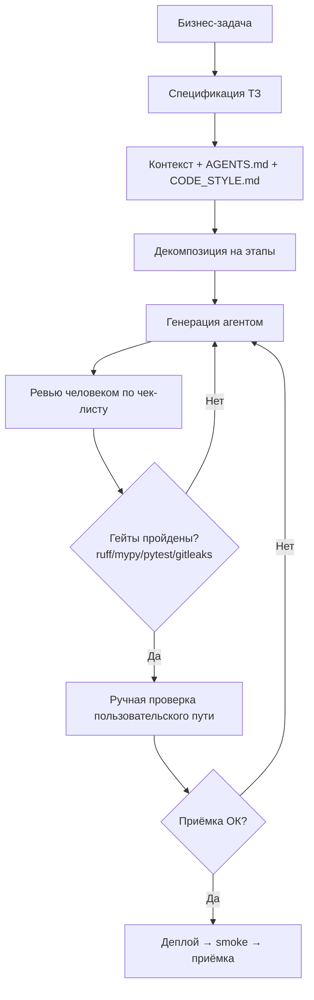

> Назад: [оглавление](00-index.md)

# 2. Архитектура harness

```
        БИЗНЕС-ЗАДАЧА
              │
              ▼
    ┌───────────────────────┐
    │ 1. Спецификация (ТЗ)  │  пользовательские сценарии, метрики, scope v1,
    │    отдельный документ  │  UX-контракт, данные, платежи, риски
    └───────────┬───────────┘
                │
                ▼
    ┌───────────────────────┐
    │ 2. Контекст            │  AGENTS.md, CODE_STYLE.md, .env.example,
    │    проектирование      │  контракты, шаблоны ТЗ, релевантные файлы
    └───────────┬───────────┘
                │
                ▼
    ┌───────────────────────┐
    │ 3. Декомпозиция       │  этапы с проверяемым результатом;
    │    задачи              │  флагманский проект задаёт шаблон первым
    └───────────┬───────────┘
                │
        ┌───────┴────────┐
        ▼                ▼
  ┌──────────┐    ┌─────────────┐
  │ Генерация│    │ Ревью кода  │  цикл до зелёных гейтов
  │ (агент)  │───▶│ (человек)   │
  └──────────┘    └──────┬──────┘
        ▲                │
        │                ▼
        └──── ошибки ◀──┴─── ЗАПУСК + ВЕРИФИКАЦИЯ
                                  │
                                  ▼
                          ДЕПЛОЙ / ПРИЁМКА
```

Ключевая идея: **этап без проверяемого результата — не этап.** «Добавить обработчик
заявки» — не этап. «Обработчик принимает анкету, кладёт в БД, админ получает уведомление;
проверка: тест на happy path + на повторный вызов» — этап.

## Что даёт harness

| Без harness | С harness |
|---|---|
| «Попросил модель, получил файл» | результат воспроизводится из спецификации |
| качество зависит от настроения | качество задано гейтами: ruff, mypy, pytest, gitleaks |
| ошибка всплывает у клиента | ошибка ловится тестом до деплоя |
| непонятно, кто автор | роль автора задокументирована и проверяема |

---


# Схема harness (диаграмма)


---

[← Оглавление](00-index.md) · [← 1. Что лежит в портфолио (доказательная база)](02-portfolio.md) · [3. Принципы работы с контекстом →](04-context.md)

